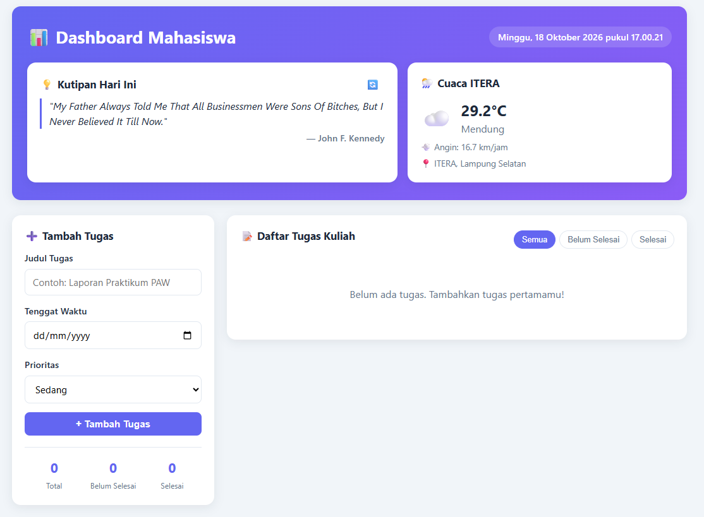

# Dashboard Mahasiswa

Aplikasi personal dashboard sederhana untuk mahasiswa, dibuat menggunakan **HTML, CSS, dan JavaScript murni (vanilla, ES6+)** tanpa framework. Data tugas disimpan di **localStorage**, dan dashboard terhubung ke **API publik riil** untuk kutipan motivasi harian serta cuaca real-time.

## Identitas

- **Nama**: Annan Try Muhammad Cintoro
- **NIM**: 124140061
- **Mata Praktikum**: Pemrograman Website
- **Kelas Praktikum**: RA

## Deskripsi Aplikasi

Dashboard Mahasiswa dibuat untuk membantu produktivitas dan organisasi tugas kuliah sehari-hari. Saat dibuka, aplikasi menyapa pengguna dengan **kutipan motivasi harian** dan **informasi cuaca real-time di sekitar ITERA, Lampung Selatan**, lalu menampilkan **daftar tugas kuliah** yang dapat dikelola penuh (tambah, edit, hapus, tandai selesai) dan tersimpan otomatis di browser.

Saat aplikasi pertama kali dijalankan (belum ada data di `localStorage`), daftar tugas awal diambil dari API JSONPlaceholder sebagai contoh data, kemudian langsung disimpan ke `localStorage` agar bisa dikelola secara lokal selanjutnya.

## Fitur Utama

- [x] **Tambah tugas** baru lengkap dengan judul, tenggat waktu, dan tingkat prioritas (Tinggi/Sedang/Rendah).
- [x] **Edit tugas** langsung di tempat (inline edit) tanpa modal/popup terpisah.
- [x] **Hapus tugas** dengan konfirmasi sebelum data dihapus permanen.
- [x] **Tandai selesai/belum selesai** melalui checkbox, dengan efek coret pada judul tugas yang selesai.
- [x] **Filter tugas**: Semua / Belum Selesai / Selesai.
- [x] **Statistik ringkas**: total tugas, belum selesai, dan selesai.
- [x] **Penanda tugas terlambat** (overdue) otomatis berdasarkan tenggat waktu yang sudah lewat.
- [x] **Penyimpanan otomatis** ke `localStorage` setiap kali data tugas berubah, dan dimuat kembali saat halaman dibuka ulang.
- [x] **Inisialisasi data awal** dari API publik (JSONPlaceholder) jika `localStorage` masih kosong.
- [x] **Widget kutipan motivasi harian** dari API DummyJSON, dengan tombol untuk memuat kutipan baru.
- [x] **Widget cuaca real-time** kampus ITERA dari API Open-Meteo (suhu, kondisi cuaca, kecepatan angin).
- [x] **Jam & tanggal real-time** yang diperbarui setiap detik.

## Struktur Proyek

```
annantrymuhammadcintoro_124140061_pertemuan2/
├── index.html       # Struktur halaman (header widget, form tugas, daftar tugas)
├── css/
│   └── style.css    # Styling tampilan, kartu, dan layout responsif
├── js/
│   └── app.js       # Seluruh logika aplikasi (class, localStorage, fetch API)
└── README.md
```

## Tangkapan Layar



## Cara Menjalankan

Tidak memerlukan instalasi dependency atau server backend.

### Menggunakan browser lokal

1. Buka folder proyek ini.
2. Buka file `index.html` dengan klik dua kali atau pilih browser melalui **Open with**.

### Menggunakan Live Server di VS Code

1. Buka folder proyek ini di VS Code.
2. Pasang ekstensi **Live Server** jika belum tersedia.
3. Buka `index.html`, lalu klik **Go Live** pada status bar atau klik kanan file dan pilih **Open with Live Server**.
4. Aplikasi akan terbuka di browser. Perubahan file dapat dilihat dengan memuat ulang halaman.

> Catatan: widget kutipan dan cuaca membutuhkan koneksi internet karena mengambil data dari API publik eksternal.

## Teknologi

- HTML5 (semantik)
- CSS3 (Flexbox & CSS Grid untuk layout responsif, CSS variables)
- JavaScript ES6+ (vanilla, tanpa dependency eksternal)
- Web Storage API (`localStorage`)
- Fetch API (`async/await`) ke API publik eksternal

## Sumber API Publik yang Digunakan

| Kebutuhan | Endpoint | Keterangan |
|---|---|---|
| Data tugas awal | `https://jsonplaceholder.typicode.com/todos?_limit=5` | Dipakai sekali saat `localStorage` masih kosong, lihat `fetchInitialTasks()` di `js/app.js` baris 96–106 |
| Kutipan motivasi harian | `https://dummyjson.com/quotes/random` | Dipanggil ulang setiap klik tombol 🔄, lihat `loadQuote()` di `js/app.js` baris 314–329 |
| Cuaca real-time ITERA | `https://api.open-meteo.com/v1/forecast?latitude=-5.36&longitude=105.31&current_weather=true&timezone=Asia%2FJakarta` | Dipanggil sekali saat aplikasi dimuat, lihat `loadWeather()` di `js/app.js` baris 334–360 |

Ketiga API di atas bersifat **gratis dan tidak memerlukan API key**.

## Daftar Fitur ES6+ yang Diimplementasikan

Semua baris merujuk pada file `js/app.js` kecuali disebutkan lain.

### 1. `let` dan `const`
- `const` digunakan untuk seluruh konstanta endpoint API dan key storage: baris 6–10 (`STORAGE_KEY`, `TODOS_API`, `QUOTE_API`, `WEATHER_API`).
- `const` untuk nilai yang tidak diubah ulang di dalam fungsi, contohnya `const stored = localStorage.getItem(...)` (baris 77) dan `const filteredTasks = this.getFilteredTasks()` (baris 171).
- `let` digunakan ketika nilai variabel memang perlu diubah ulang (reassignment), misalnya deklarasi `icon` dan `description` pada baris 364–365 yang nilainya ditentukan ulang berdasarkan hasil `switch` pada baris 367–398 di fungsi `getWeatherInfo`.

### 2. Arrow Functions (minimal 3 — berikut sebagian besarnya)
- `fetchInitialTasks = async () => {...}` — baris 96
- `addTask = ({ title, dueDate, priority }) => {...}` — baris 115
- `updateTask = (id, { title, dueDate, priority }) => {...}` — baris 131
- `toggleComplete = (id) => {...}` — baris 139
- `deleteTask = (id) => {...}` — baris 147
- `getFilteredTasks = () => {...}` — baris 159
- `renderTaskItem = ({ id, title, dueDate, priority, completed, isOverdue }) => {...}` — baris 180
- `escapeHtml = (text = '') => text.replace(...)` — baris 222
- `getWeatherInfo = (code, isDay = true) => {...}` — baris 363
- Serta banyak arrow function sebagai callback `.map()`, `.filter()`, dan `addEventListener()`, contohnya pada baris 81, 102–104, 132–134, 162–164, 250, 254, 301.

### 3. Template Literals
- Merender kartu tugas secara dinamis di `renderTaskItem()`, baris 182–219 (menyisipkan `id`, `title`, `priority`, status `completed`, tombol aksi, dsb).
- Menampilkan kutipan: `` this.quoteTextEl.textContent = `"${quote}"` `` — baris 323.
- Menampilkan hasil cuaca (suhu, deskripsi, kecepatan angin): baris 345–355.
- Membuat `id` unik tugas: `` `task-${Date.now()}` `` (baris 120) dan `` `seed-${id}` `` (baris 104).

### 4. Fungsi Asinkron — `async/await`
- `async init()` — baris 64, mengatur urutan pemuatan data saat aplikasi dibuka.
- `async loadTasks()` dengan `try/catch` — baris 76–94.
- `fetchInitialTasks = async () => {...}` memanggil `fetch()` ke JSONPlaceholder — baris 96–106.
- `async loadQuote()` memanggil `fetch()` ke DummyJSON — baris 314–329.
- `async loadWeather()` memanggil `fetch()` ke Open-Meteo — baris 334–360.

### 5. Classes
- `class TaskItem` — baris 16–31, memodelkan struktur data tugas (termasuk getter `isOverdue`).
- `class DashboardApp` — baris 37–425, mengelola seluruh state aplikasi, operasi `localStorage`, rendering DOM, dan pemanggilan `fetch()` ke API eksternal.

### 6. Destructuring pada Parameter Fungsi
- `constructor({ id, title, dueDate = '', priority = 'sedang', completed = false })` pada `TaskItem` — baris 17.
- `addTask = ({ title, dueDate, priority }) => {...}` — baris 115.
- `updateTask = (id, { title, dueDate, priority }) => {...}` — baris 131.
- `renderTaskItem = ({ id, title, dueDate, priority, completed, isOverdue }) => {...}` — baris 180.
- `data.map(({ id, title, completed }) => ...)` — baris 102–104.
- `({ target }) => this.toggleComplete(target.dataset.id)` pada event listener checkbox — baris 250.
- Destructuring hasil `fetch()`: `const { quote, author } = await response.json()` (baris 322) dan `const { current_weather } = await response.json()` (baris 341).

### 7. Spread Operator (immutable state update)
- Menambah tugas baru tanpa memutasi array lama: `this.tasks = [newTask, ...this.tasks]` — baris 126.
- Memperbarui tugas: `new TaskItem({ ...task, title, dueDate, priority })` — baris 133.
- Toggle status selesai: `new TaskItem({ ...task, completed: !task.completed })` — baris 141.

## Catatan Implementasi

- Kode di `js/app.js` dikelompokkan dengan komentar penanda (`KONSTANTA`, `CLASS: TaskItem`, `CLASS: DashboardApp`, `CRUD TUGAS`, `FETCH API`, dst.) agar mudah dibaca dan dikembangkan.
- Judul tugas di-escape (`escapeHtml`) sebelum dirender ke HTML untuk mencegah injeksi HTML sederhana.
- State tugas (`this.tasks`) selalu diperbarui secara **immutable** (tidak pernah dimodifikasi langsung dengan `push`/`splice`), melainkan dibuat array baru menggunakan `map`, `filter`, atau spread operator, lalu disimpan ulang ke `localStorage`.
- Tampilan responsif: pada layar lebar, form dan daftar tugas ditampilkan berdampingan; pada layar sempit (mobile), otomatis bertumpuk menjadi satu kolom.
