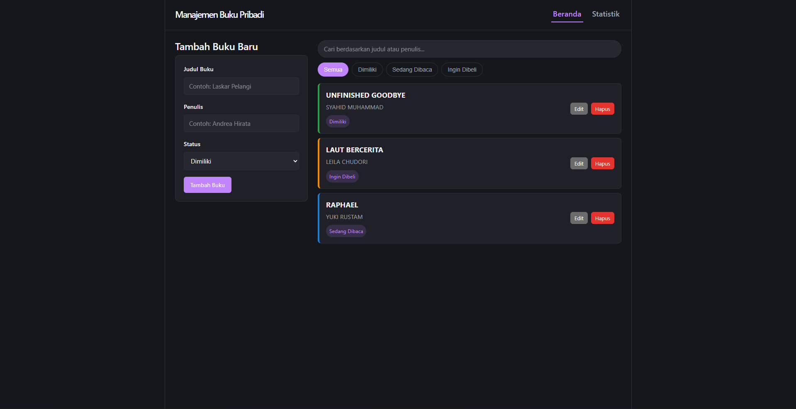
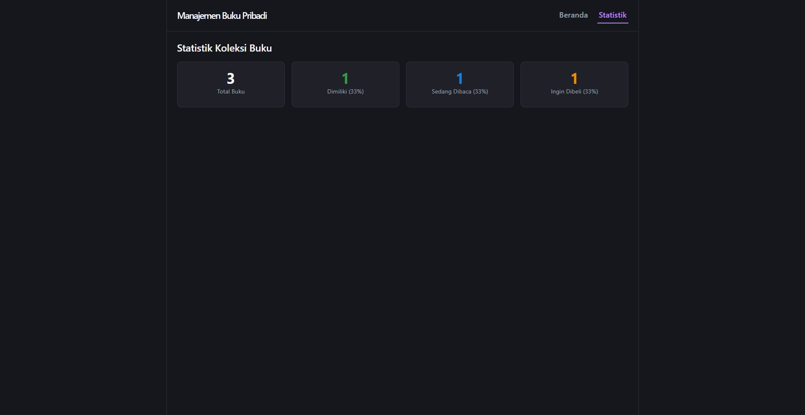
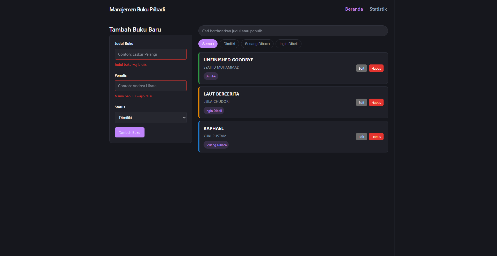
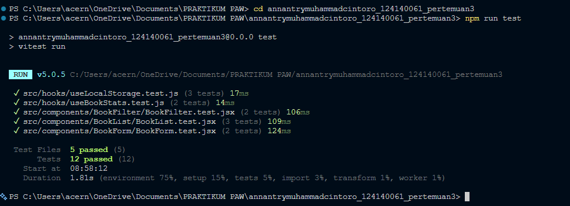

# Aplikasi Manajemen Buku Pribadi

Tugas Praktikum Pemrograman Aplikasi Web - Pertemuan 3
Nama: Annantry Muhammad Cintoro
NIM: 124140061

## 1. Deskripsi Aplikasi

Aplikasi ini adalah sebuah **Single Page Application (SPA)** berbasis React yang
membantu pengguna mencatat koleksi buku pribadinya. Setiap buku dicatat dengan
judul, nama penulis, dan status kepemilikannya, yaitu salah satu dari:

- **Dimiliki** - buku yang sudah dimiliki
- **Sedang Dibaca** - buku yang sedang dalam proses dibaca
- **Ingin Dibeli** - buku yang masuk wishlist untuk dibeli

Pengguna dapat menambah, mengedit, dan menghapus data buku, memfilter daftar
buku berdasarkan status, serta mencari buku berdasarkan judul atau nama
penulis. Seluruh data disimpan di `localStorage` browser sehingga data tidak
hilang walaupun halaman di-refresh atau browser ditutup. Aplikasi juga
menyediakan halaman **Statistik** yang menampilkan ringkasan jumlah buku per
status beserta persentasenya.

## 2. Instruksi Instalasi dan Menjalankan Aplikasi

### Prasyarat

- [Node.js](https://nodejs.org/) versi 18 ke atas
- npm (sudah termasuk saat instalasi Node.js)

### Langkah-langkah

1. Masuk ke folder project:

   ```bash
   cd annantrymuhammadcintoro_124140061_pertemuan3
   ```

2. Install seluruh dependency:

   ```bash
   npm install
   ```

3. Jalankan aplikasi dalam mode development:

   ```bash
   npm run dev
   ```

   Lalu buka URL yang muncul di terminal (biasanya `http://localhost:5174`).

4. Build aplikasi untuk production (opsional):

   ```bash
   npm run build
   npm run preview
   ```

5. Menjalankan unit test:

   ```bash
   npm run test
   ```

   Atau mode watch (otomatis re-run saat ada perubahan kode):

   ```bash
   npm run test:watch
   ```

## 3. Screenshot Antarmuka Aplikasi

**Halaman Beranda (tambah, edit, filter, dan cari buku)**



**Halaman Statistik**



**Contoh validasi form saat input kosong**



## 4. Penjelasan Fitur React yang Digunakan

| Fitur React | Lokasi Pemakaian | Keterangan |
| --- | --- | --- |
| `useState` | `BookForm`, `Home`, `BookContext` (lewat `useLocalStorage`) | Menyimpan state form, filter, kata kunci pencarian, dan data buku. |
| `useEffect` | `src/hooks/useLocalStorage.js`, `src/pages/Home/Home.jsx` | Menyinkronkan state ke `localStorage` setiap berubah, dan mengubah judul tab browser sesuai jumlah buku. |
| `useMemo` | `src/pages/Home/Home.jsx`, `src/hooks/useBookStats.js` | Menghindari perhitungan ulang (filter+pencarian, statistik) yang tidak perlu di setiap render. |
| `useCallback` | `src/context/BookContext.jsx` | Memastikan fungsi `addBook`, `updateBook`, `deleteBook` tidak dibuat ulang di setiap render context. |
| Context API | `src/context/BookContext.jsx` | Menyediakan data buku (`books`) dan fungsi CRUD ke seluruh komponen tanpa prop drilling, lewat `BookProvider` dan custom hook `useBooks()`. |
| React Router | `src/App.jsx`, `src/components/Navbar/Navbar.jsx` | Navigasi multi-halaman antara halaman Beranda (`/`) dan Statistik (`/stats`) memakai `BrowserRouter`, `Routes`, `Route`, dan `NavLink`. |
| Custom Hooks | `src/hooks/useLocalStorage.js`, `src/hooks/useBookStats.js` | `useLocalStorage` untuk persistensi data, `useBookStats` untuk menghitung statistik koleksi buku. |
| PropTypes | Semua komponen di `src/components` dan `src/context` | Validasi tipe data props di setiap komponen. |
| Error Handling / Validasi Form | `src/components/BookForm/BookForm.jsx` | Validasi judul & penulis wajib diisi, dengan feedback visual (border merah + pesan error) saat kosong. |

### Komponen Reusable

Aplikasi ini memiliki lebih dari 3 komponen reusable:

1. **`BookForm`** - form tambah/edit buku (dipakai ulang untuk kedua mode).
2. **`BookList`** - daftar buku, menerima array buku apa pun lewat props.
3. **`BookItem`** - satu baris/kartu buku di dalam `BookList`.
4. **`BookFilter`** - tombol filter status, fully controlled lewat props.
5. **`BookSearch`** - input pencarian, fully controlled lewat props.
6. **`Navbar`** - navigasi antar halaman.

## 5. Struktur Folder

```
src/
├── components/
│   ├── BookForm/
│   ├── BookList/
│   ├── BookItem/
│   ├── BookFilter/
│   ├── BookSearch/
│   └── Navbar/
├── pages/
│   ├── Home/
│   └── Stats/
├── hooks/
│   ├── useLocalStorage.js
│   └── useBookStats.js
├── context/
│   └── BookContext.jsx
├── test/
│   └── setup.js
├── App.jsx
└── main.jsx
```

Komentar penting dijelaskan langsung di dalam kode (lihat masing-masing file
`.jsx`/`.js`) terutama di bagian yang menjelaskan alasan desain, seperti kenapa
state filter/pencarian disimpan lokal di halaman `Home` dan bukan di dalam
`BookContext`.

## 6. Laporan Testing

Unit test ditulis menggunakan **Vitest** + **React Testing Library**, mencakup
custom hooks (`useLocalStorage`, `useBookStats`) dan komponen (`BookForm`,
`BookList`, `BookFilter`), dengan total 12 test case.

Jalankan dengan:

```bash
npm run test
```


