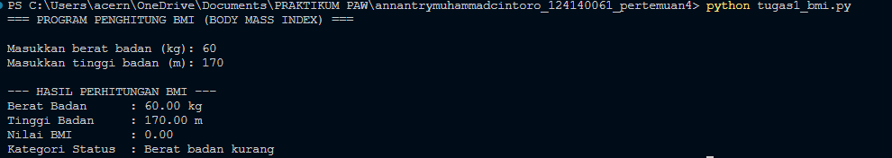
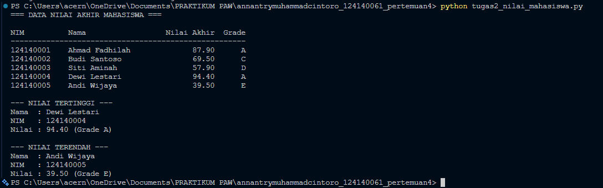
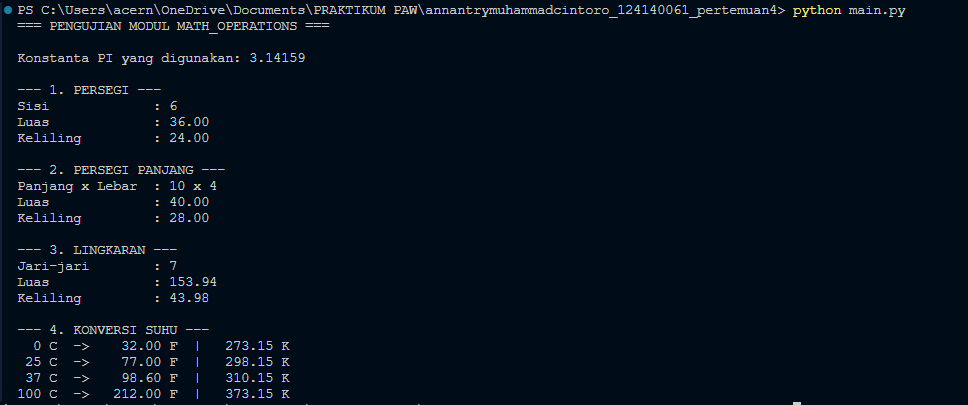

# Tugas Pertemuan 4 — Dasar Pemrograman Python

## Identitas Mahasiswa
- **Nama   :** Annan Try Muhammad Cintoro
- **NIM    :** 124140061
- **Prodi  :** Teknik Informatika

## Deskripsi Program

### 1. `tugas1_bmi.py` — Penghitung BMI (Body Mass Index)
Program meminta input berat badan (kg) dan tinggi badan (m) dari pengguna,
lalu menghitung nilai BMI dengan rumus `BMI = berat / (tinggi * tinggi)`.
Nilai BMI tersebut kemudian diklasifikasikan ke dalam 4 kategori status
berat badan menggunakan struktur `if-elif-else`:

| Rentang BMI      | Kategori              |
|-------------------|------------------------|
| < 18.5            | Berat badan kurang     |
| 18.5 – 24.9       | Berat badan normal     |
| 25.0 – 29.9       | Berat badan berlebih   |
| ≥ 30              | Obesitas                |

### 2. `tugas2_nilai_mahasiswa.py` — Pengelolaan Data Nilai Mahasiswa
Program menyimpan data 5 mahasiswa (nama, NIM, nilai UTS, UAS, dan Tugas)
dalam sebuah `list` berisi `dictionary`. Nilai akhir setiap mahasiswa
dihitung dengan bobot:

```
Nilai Akhir = (30% x UTS) + (40% x UAS) + (30% x Tugas)
```

Grade huruf (A–E) ditentukan dari nilai akhir tersebut, lalu seluruh data
ditampilkan dalam format tabel rapi. Program juga mencari dan menampilkan
mahasiswa dengan nilai akhir **tertinggi** dan **terendah** menggunakan
fungsi `max()` dan `min()` dengan `key` berupa `lambda`.

### 3. `math_operations.py` & `main.py` — Modul Matematika Python
- **`math_operations.py`** adalah modul kustom yang berisi:
  - Fungsi luas & keliling untuk **persegi**, **persegi panjang**, dan
    **lingkaran**.
  - Fungsi konversi suhu **Celsius → Fahrenheit** dan **Celsius → Kelvin**.
  - Konstanta `PI = 3.14159`.
  - Blok `if __name__ == "__main__":` untuk pengujian mandiri modul.
- **`main.py`** adalah program utama yang mengimpor dan menguji seluruh
  fungsi pada `math_operations.py`, dengan dua cara impor berbeda:
  - `import math_operations` (impor seluruh modul)
  - `from math_operations import celsius_ke_fahrenheit, celsius_ke_kelvin, PI`
    (impor fungsi & konstanta spesifik)

## Cara Menjalankan Program

Pastikan Python 3.8+ sudah terpasang. Buka folder
`annantrymuhammadcintoro_124140061_pertemuan4` di VS Code, pilih
**Terminal → New Terminal**, lalu pastikan terminal berada di folder ini.
Jalankan setiap program dengan perintah berikut:

```bash
# Soal 1: Penghitung BMI (akan meminta input berat & tinggi badan)
python tugas1_bmi.py

# Soal 2: Pengelolaan data nilai mahasiswa
python tugas2_nilai_mahasiswa.py

# Soal 3: Modul matematika (pengujian mandiri modul)
python math_operations.py

# Soal 3: Program utama yang memanggil math_operations.py
python main.py
```

## Screenshot Hasil Eksekusi

### Soal 1 — `tugas1_bmi.py`


### Soal 2 — `tugas2_nilai_mahasiswa.py`


### Soal 3 — `main.py`


## Struktur Folder

```
annantrymuhammadcintoro_124140061_pertemuan4/
├── .gitignore
├── main.png
├── main.py
├── math_operations.py
├── README.md
├── tugas1_bmi.png
├── tugas1_bmi.py
├── tugas2_nilai_mahasiswa.png
└── tugas2_nilai_mahasiswa.py
```
